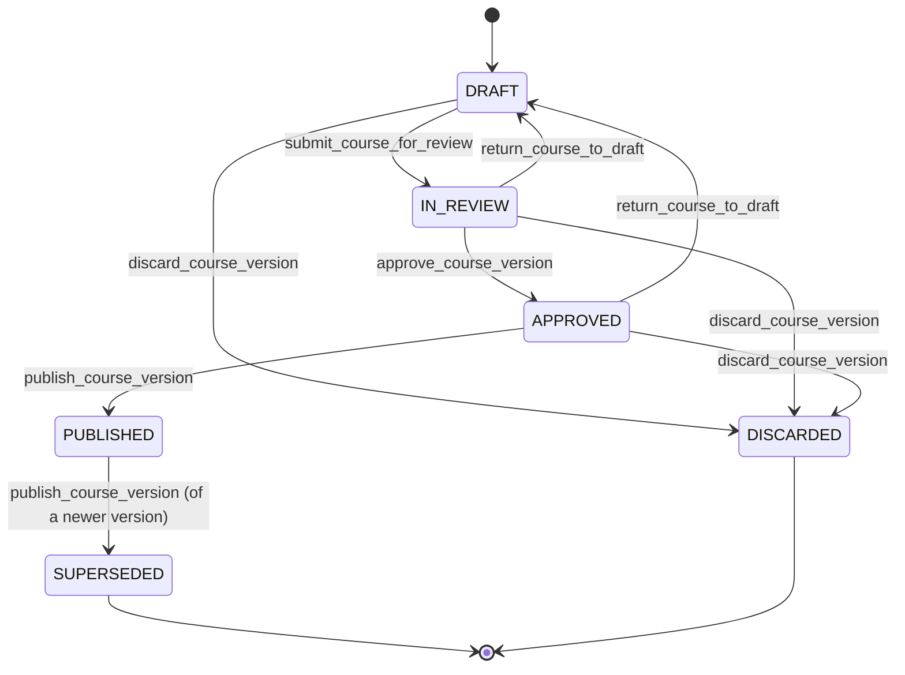
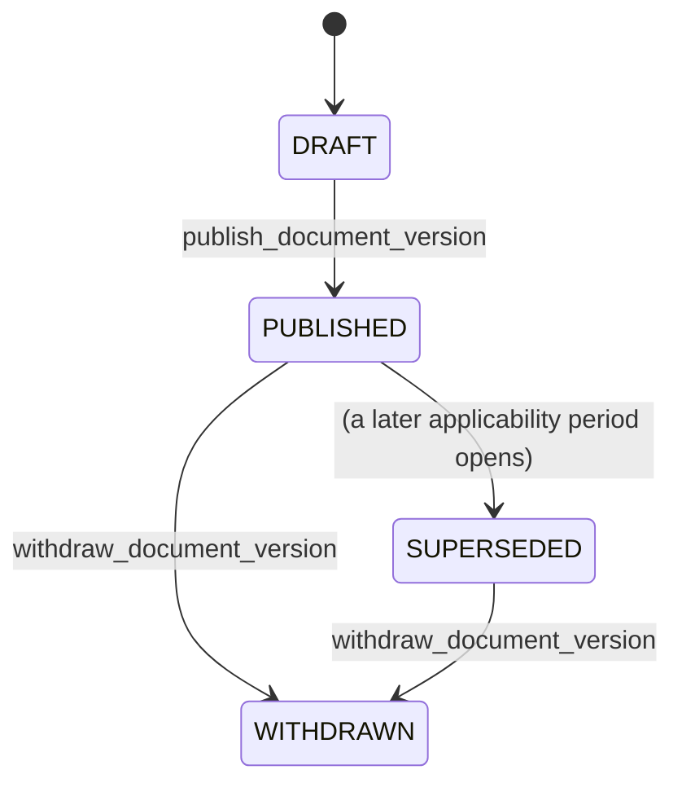
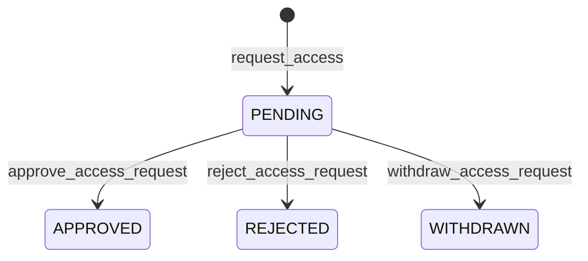
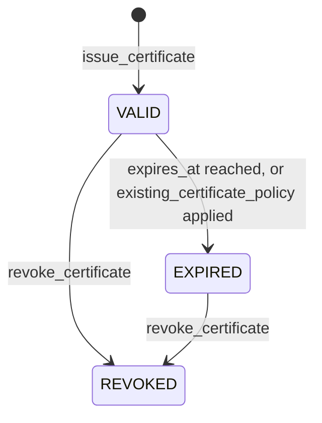
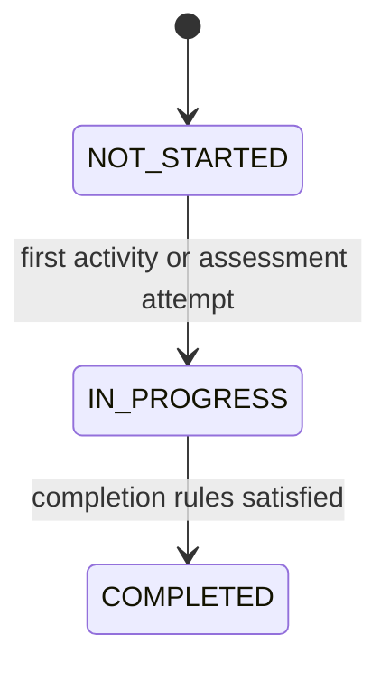
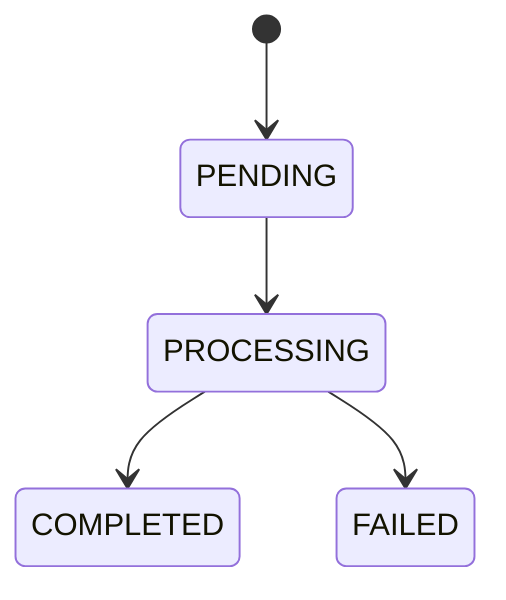

# State Machines

Lifecycle rules elsewhere in this documentation are written as prose. This file
is the machine-readable form: every allowed transition, its guard, its required
permission, and its side effects.

**Any transition not listed here is forbidden.** Reaching a state by direct ORM
assignment rather than through the named service function is a defect.

Illegal transition attempts return `COURSE_INVALID_STATE_TRANSITION` or the
domain-specific code named in `error-codes.md`.

---

## CourseVersion

### Version numbers belong to published versions

`version_number` is `NULL` until publication and is assigned there, as
`max(published version_number) + 1`. A version that never publishes never
consumes a number.

That keeps the sequence meaningful: v1, v2, v3 are three things that were
actually released, not three things that were attempted. A course whose second
attempt was abandoned does not have a gap where v2 should be, and nobody has to
explain what happened to it.

Work in progress is identified by its id and its creation date until then. The
authoring interface shows "Draft, started 2026-08-26" rather than a number it
might not keep.

| From | To | Service function | Permission | Guard | Side effects |
|---|---|---|---|---|---|
| — | `DRAFT` | `create_course_version` | `academy.course.create` | At most one version per course in `DRAFT`, `IN_REVIEW` or `APPROVED` at a time. | `version_number` stays `NULL`. Content is deep-copied from the source version when branching — see *What branching copies* below. |
| `DRAFT` | `IN_REVIEW` | `submit_course_for_review` | `academy.course.submit_review` | Version has ≥1 module with ≥1 lesson (`COURSE_HAS_NO_CONTENT`); every localized field has all required locales (`LOCALIZED_CONTENT_INCOMPLETE`); every block config validates. Reviewer must be assigned (`COURSE_REVIEWER_NOT_ASSIGNED`), and must be an active person other than the author (`VALIDATION_ERROR`). | Sets `submitted_at`, `submitted_by`, `assigned_reviewer`. Notifies the reviewer. Content becomes read-only. |
| `IN_REVIEW` | `DRAFT` | `return_course_to_draft` | `academy.course.review` or `academy.course.withdraw` | Reviewer or author side may return it. Requires a reason. The route checks the permission against the version's status. | Clears review fields. Notifies the author. Audited. |
| `IN_REVIEW` | `IN_REVIEW` | `complete_course_review` | `academy.course.review` | Only the **assigned reviewer** (`PERMISSION_DENIED` otherwise). A reviewer who cannot do it is replaced by returning the version and submitting it again. | Sets `reviewed_at`, `reviewed_by`. Not approval. |
| `IN_REVIEW` | `APPROVED` | `approve_course_version` | `academy.course.approve` — held by Content Author, Quality Approver, Content Administrator and Platform Administrator | **`actor != created_by`** (`COURSE_AUTHOR_CANNOT_APPROVE`), enforced in the service and by a DB check constraint. Applies to every role without exception, Platform Administrator included. Review must be complete (`reviewed_at` set). | Sets `approved_at`, `approved_by`. Emits `academy.course_version.approved`. |
| `APPROVED` | `DRAFT` | `return_course_to_draft` | `academy.course.approve` | Requires a reason. | Clears approval fields. Audited. |
| `APPROVED` | `PUBLISHED` | `publish_course_version` | `academy.course.publish` | Version is `APPROVED` (`COURSE_NOT_APPROVED`). No other `PUBLISHED` version for this course after this transaction. | One transaction: assigns `version_number`; sets publication fields; supersedes the previous version; applies the three policies below; emits `academy.course_version.published`. |
| `DRAFT` / `IN_REVIEW` / `APPROVED` | `DISCARDED` | `discard_course_version` | `academy.course.withdraw` | Requires a reason. A `PUBLISHED` or `SUPERSEDED` version can never be discarded — released content is superseded, not erased. | Sets `discarded_at`, `discarded_by`, `discard_reason`. The row and its content tree are retained. Audited. |
| `PUBLISHED` | `SUPERSEDED` | (inside `publish_course_version`) | — | Only as part of publishing a newer version. Never a standalone action. | Sets `superseded_at`, `superseded_by`. **Existing `Certificate` and `Enrollment` rows keep pointing at this version.** |

### Publishing a new version asks three separate questions

They are separate because their answers are, and collapsing them is how a
routine publish quietly does something consequential:

| Question | Policy | Decided by |
|---|---|---|
| What happens to someone **part-way through** the old version? | `in_progress_policy` | The publisher, at publication |
| What happens to someone who **already completed** it? | `new_version_policy` | The author, when the course is written |
| What happens to the **certificate** they hold? | `existing_certificate_policy` | The author, when the course is written |

The first is set at publication rather than at authoring because it depends on
the change: a typo correction and a rewritten protocol call for different
answers, and only the person releasing it knows which this is.

### `in_progress_policy` application

Governs learners whose enrollment on the outgoing version is `IN_PROGRESS`.

| Policy | Effect |
|---|---|
| `ALLOW_GRACE_PERIOD` *(default)* | The learner finishes the version they started, within `in_progress_grace_period_days`. Their enrollment stays usable and the superseded content stays readable **to them**. A new enrollment on the new version is created alongside it. |
| `MOVE_IMMEDIATELY` | The outgoing enrollment is closed — `grace_period_ends_at` is set to the moment of publication, so access ends now — and a fresh enrollment is created on the new version. Its status and `completed_at` are left as they were: closing is not completing, and the training record must not say they finished a version they did not. Progress does not carry over: they start again. |

`ALLOW_GRACE_PERIOD` is the default because interrupting someone mid-course
punishes them for a change they did not make. `MOVE_IMMEDIATELY` exists for the
case where the old content is wrong enough that finishing it would be worse than
starting over.

Under either policy, a learner who has **not started** the outgoing version is
simply enrolled on the new one; there is nothing to preserve.

> Superseded course content stays readable to learners who hold an active
> enrollment on it, and to anyone holding a certificate for it. This mirrors
> e-IFU, where a superseded document remains retrievable for the lots it
> covers: what someone was trained on has to remain inspectable, or the
> certificate refers to something nobody can see.

### `new_version_policy` application

Applied in the same transaction as publication. It governs **learners**:

| Policy | Effect on learners who completed the previous version |
|---|---|
| `NO_ACTION` | Nothing. |
| `ASSIGN_NEW_VERSION` | A new `Enrollment` is created for the new version. |
| `REQUIRE_RECERTIFICATION` | A new `Enrollment` is created, and `existing_certificate_policy` below decides what happens to the certificate they already hold. |

### `existing_certificate_policy` application

Consulted **only** when `new_version_policy = REQUIRE_RECERTIFICATION`. It governs
**certificates**, which is a separate question from whether someone must retrain:

| Policy | Effect on an already-issued certificate for the previous version |
|---|---|
| `KEEP_UNTIL_EXPIRY` *(default)* | Untouched. It runs to its own `expires_at`, or stays valid indefinitely if it has none. The learner retrains; their existing credential is not retroactively voided. |
| `EXPIRE_AFTER_GRACE_PERIOD` | `expires_at` is set to `now + recertification_grace_period_days`, but only where that is **earlier** than the existing `expires_at`. A grace period never extends a certificate. |
| `EXPIRE_IMMEDIATELY` | Status becomes `EXPIRED` at publication. |

In every case the certificate row is retained, and it is never marked `REVOKED` —
superseding content is not misconduct, and the public verification result must not
imply that it was.

> Immediate expiry is **not** an invariant of publication. Voiding a credential
> that still had months to run is a consequential business act; it is available,
> and it is chosen deliberately per course, not applied as a side effect of a
> routine publish. `KEEP_UNTIL_EXPIRY` is the default.

### What branching copies

`create_course_version` deep-copies the content tree from the source version.
The list of what it does **not** copy is the safety-critical half: learner data
belongs to a person and a version, and a copy of it appearing under a new
version would attribute someone's attempt to content they never saw.

| Copied | Not copied |
|---|---|
| `Module`, with `display_order` | `Enrollment` |
| `Lesson`, with `display_order` | `LessonCompletion` |
| `ContentBlock`, with `config`, `schema_version`, `display_order`, `is_scoreable` | `ActivityAttempt` |
| `Assessment`, with every setting including `passing_score`, `max_attempts`, `remediation_policy` | `AssessmentAttempt` |
| `Question`, with `prompt`, `options`, `correct_answer`, `points`, `display_order` | `Certificate` |
| Localized fields, in every locale present | Review, approval and publication fields — the copy starts as a fresh `DRAFT` |

Ordering is preserved exactly. `display_order` is unique per parent, so the copy
walks the tree in order and re-numbers nothing.

`config` is copied as stored, with its `schema_version`. A branch is not a
migration: if a block's schema has moved on, the copy keeps the old version and
the block validates against the schema it declares.

### Content is read-only outside `DRAFT`

Modules, lessons, blocks, assessments and questions may only be created, edited,
reordered or deleted while their version is `DRAFT`. Every other status refuses,
with `COURSE_VERSION_NOT_EDITABLE`.

Enforced in the service layer, not by convention. The content tree is a wide
surface — five models with cascade deletes — and "published content is
immutable" is worth nothing if it lives only in this document. A single guard
that every content-mutating service calls is the whole implementation.

### Invariants

1. Review, approval and publication are three distinct transitions. Approval never implies publication.
2. `PUBLISHED` and `SUPERSEDED` content is immutable. Corrections require a new version.
3. At most one `PUBLISHED` version per course, enforced by a partial unique index.
4. Superseding never rewrites historical `Certificate` or `Enrollment` linkage.
5. Publishing a new version never expires an existing certificate unless the
   course's `existing_certificate_policy` says so. The default does not.

---

## DocumentVersion (e-IFU)

| From | To | Service function | Permission | Guard | Side effects |
|---|---|---|---|---|---|
| — | `DRAFT` | `create_document_version` | `eifu.document.manage` | Unique `(document, revision)`. | |
| `DRAFT` | `PUBLISHED` | `publish_document_version` | `eifu.document.publish` | ≥1 active `DocumentFile`; `proposed_effective_from` is set; no period overlap results for the product (`EIFU_APPLICABILITY_OVERLAP`). | One transaction: closes the previous applicability period at the new `effective_from`, then **creates** the `DocumentApplicability` row — applicability exists only for published facts, never for drafts. Emits `eifu.document_version.published`. |
| `PUBLISHED` | `SUPERSEDED` | (inside `publish_document_version`) | — | A newer version's period starts. | Sets `effective_to` on the prior applicability. **Remains publicly resolvable for LOTs in its period.** |
| `PUBLISHED` / `SUPERSEDED` | `WITHDRAWN` | `withdraw_document_version` | `eifu.document.withdraw` | Requires a reason. `reopen_previous` requires this version to hold an open period (`EIFU_NO_PERIOD_TO_REOPEN`). | Sets `DocumentApplicability.withdrawn_at`, which removes the version from resolution and releases its period from the overlap constraint. The applicability row is retained. LOTs in that period return `EIFU_NO_APPLICABLE_VERSION` — they are **never silently** moved to another revision. Optionally reopens the predecessor; see below. Audited, recording what was reopened. |

### What happens to the period a withdrawal leaves behind

Withdrawing the revision that holds the open period leaves that period
uncovered. Two outcomes are correct in different circumstances, and the system
cannot tell them apart:

| Why it was withdrawn | Correct outcome |
|---|---|
| Published in error — wrong product, wrong file, should never have gone out | The predecessor reopens. The correct state of the world is the one before it. |
| Content recalled — the revision itself is wrong | The gap stays. The predecessor was superseded for a reason, and serving it again would hand a laboratory a document quality had already moved past. |

So `reopen_previous` is asked, not inferred. The default leaves the gap, which
fails loudly; reopening is a deliberate act by someone who knows why they are
withdrawing.

Reopening sets the predecessor's `effective_to` back to `NULL` and returns it
from `SUPERSEDED` to `PUBLISHED` — nothing supersedes it any more. Order matters
inside the transaction: the withdrawn row is stamped first, because the
exclusion constraint is immediate and the predecessor cannot grow back into an
occupied period.

It applies only to a version holding an **open** period. Withdrawing a closed
one leaves a hole between two dated periods, and filling it from either side
would be inventing coverage nobody approved.

`SUPERSEDED` is not an end state for retrieval. A 2024 LOT must still resolve to
its superseded 2024 revision. See `eifu-domain.md`.

### DocumentFile

A file is not a state machine, but replacement is a controlled transition:

| Action | Service function | Permission | Effect |
|---|---|---|---|
| Replace a published file | `replace_published_document_file` | `eifu.document.replace_published_file` | Requires a reason. Atomically: sets `is_active = false` on the old row (never deletes it or its object), inserts the new row, writes a `DocumentFileReplacement` capturing both hashes, actor, timestamp and reason, and emits `eifu.document_file.replaced`. |

### LotDocumentOverride

| Action | Service function | Permission | Effect |
|---|---|---|---|
| Create | `LotOverrideService.create` | `eifu.lot_override.manage` | Requires a reason (`EIFU_REASON_REQUIRED`). Target must be `PUBLISHED` or `SUPERSEDED` (`EIFU_OVERRIDE_TARGET_NOT_PUBLISHED`) and belong to the LOT's product (`EIFU_OVERRIDE_TARGET_WRONG_PRODUCT`). Fails if an active override exists (`EIFU_OVERRIDE_ALREADY_ACTIVE`). Audited. |
| Deactivate | `LotOverrideService.deactivate` | `eifu.lot_override.manage` | Requires a reason. Sets `is_active = false`; the row is retained. Audited. |

An active override short-circuits date-based resolution — and only an override does.

### Lot manufacturing date

A LOT has no status column; the state that matters is `has_date_conflict`,
which the resolver checks before anything else (step 5 of
`eifu-resolution-specification.md`) and which an override therefore does not
get past.

| Action | Service function | Permission | Effect |
|---|---|---|---|
| Register | `CatalogService.createLot` | `catalog.lot.manage` | Date parsed from the LOT (`PARSED_FROM_LOT`), or supplied (`SUPPLIED`). A supplied date that differs from the parsed one sets `has_date_conflict`; neither wins automatically (ADR-0008 §6). Audited with both dates. |
| Correct the date | `CatalogService.correctLotDate` | `catalog.lot.correct` | The only transition that clears `has_date_conflict`. A person chooses the date; requires a reason. Sets `manufacturing_date_source = MANUAL_CORRECTION`. Audited with the date before, the date after, and the parsed date. |

## CourseAccessRequest

| From | To | Service function | Permission | Guard | Side effects |
|---|---|---|---|---|---|
| — | `PENDING` | `CatalogueService.request` | `academy.learning.participate` | The course is listed, active, published and in the caller's audience **by membership** (`CourseAudienceService.offeredTo` — an author's view of every course is not audience) (`COURSE_NOT_IN_CATALOGUE`); the caller is not already enrolled or offered it (`ACCESS_REQUEST_NOT_NEEDED`); no other `PENDING` request (`ACCESS_REQUEST_ALREADY_PENDING`, and `accessrequest_one_pending_per_course`). | Audited. Notifies the staff responsible for the requester's distributor, or every decider when nobody is (`access_request.submitted`). |
| `PENDING` | `APPROVED` | `CatalogueService.approve` | `academy.access_request.decide` | The decider is a member of Bioeksen (`ACCESS_REQUEST_DECIDER_NOT_BIOEKSEN`) and not the requester (`ACCESS_REQUEST_SELF_DECISION`). The course is still in the requester's catalogue — listed, active, published, and in their audience by membership (`COURSE_NOT_IN_CATALOGUE`) — and `assertCovers` passes. Still `PENDING` (`ACCESS_REQUEST_NOT_PENDING`). | In one transaction: an `OPTIONAL` assignment to the requester (which enrols them), or the active one they already have. Audited. Notifies the requester. |
| `PENDING` | `REJECTED` | `CatalogueService.reject` | `academy.access_request.decide` | As for approval; a reason is required (`REASON_REQUIRED`). | Audited with the reason. Notifies the requester with it. The requester may ask again. |
| `PENDING` | `WITHDRAWN` | `CatalogueService.withdraw` | the requester | Still `PENDING`. | Audited. |

`APPROVED`, `REJECTED` and `WITHDRAWN` are final. Every transition is one
conditional update on `status = 'PENDING'`, so two deciders pressing at once
cannot both succeed.

---

## Certificate

| From | To | Service function | Permission | Guard | Side effects |
|---|---|---|---|---|---|
| — | `VALID` | `issue_certificate` | automatic on completion, or `academy.certificate.issue_manual` | `certificate_enabled` on the version; completion requirements met (`CERTIFICATE_COMPLETION_REQUIREMENTS_UNMET`); no existing certificate for `(user, course_version)` that is not `REVOKED` (`certificate_one_live_per_version`, a partial unique index). | Generates `verification_id` and `serial_number`. Computes `expires_at` from `certificate_validity_months`, or `NULL` for unlimited. |
| `VALID` | `EXPIRED` | `expire_certificates` (scheduled) or `publish_course_version` | — | `expires_at` has passed, or `existing_certificate_policy = EXPIRE_IMMEDIATELY` was applied at publication. Publication alone never expires a certificate. | Status only. The row is retained and stays publicly verifiable **as expired**. |
| `VALID` / `EXPIRED` | `REVOKED` | `revoke_certificate` | `academy.certificate.revoke` | Requires a non-empty reason (`CERTIFICATE_REVOCATION_REASON_REQUIRED`); not already `REVOKED`. | Sets `revoked_at`, `revoked_by`, `revocation_reason`. Emits `academy.certificate.revoked`. |

There is no transition out of `REVOKED`. Reinstatement means issuing a new
certificate; the revoked one is retained and continues to verify **as revoked**.

---

## Enrollment

| From | To | Guard |
|---|---|---|
| — | `NOT_STARTED` | Created on assignment, or on first access to an optional course. |
| `NOT_STARTED` | `IN_PROGRESS` | First `ActivityAttempt` or `AssessmentAttempt`. Sets `started_at`. |
| `IN_PROGRESS` | `COMPLETED` | `completion_rules` evaluated **server-side only**. Sets `completed_at`; triggers `issue_certificate` when enabled. |

`COMPLETED` is terminal for that `course_version`. A new version produces a new
`Enrollment` row; it never mutates the old one.

---

## ImportBatch

A LOT import runs in one request and one transaction, so the batch is created
`PROCESSING` and leaves it `COMPLETED` in the same transaction; `PENDING` is for
an import that would be queued, and none is today. A commit that throws is
recorded `FAILED`, with its `failure_code`, after the transaction rolls back.

`COMPLETED` means the batch finished, **not** that every row succeeded. Row
outcomes live in `ImportRowResult`. A batch with conflicts still completes, and
the conflicts stay visible for review. Import must never partially hide failures
(`eifu-imports.md`).

---

## Implementation rules

- One service function owns each transition. Controllers and the scheduler
  call it; they never set a status field directly (`check_forbidden_patterns.py`
  refuses a transition written in a controller).
- Every transition that spans more than one row runs inside one `prisma.$transaction`.
- Every transition marked audited writes its `AuditEvent` inside the same
  transaction as the state change. An audit record must not be able to survive a
  rolled-back transition, or vice versa.
- Guards are enforced in the service **and**, where expressible, as a database
  constraint. A service check alone is not sufficient for the invariants in
  `permission-matrix.md`.

## Removing draft content

A module, a lesson, a content block and a question are **deleted outright**
while their version is a `DRAFT`. Nothing is superseded and nothing is retained,
because nothing was ever published: a draft has never been read by a learner, no
attempt can reference it and no completion can name it. There is no history to
preserve because none was made. Supersession is reserved for versions, which are
what a published thing is.

Two guarantees stand behind that, and they are separate on purpose:

1. **The service refuses anything but a DRAFT** — `assertDraft`, plus the
   database trigger that holds for a caller which skipped the service.
2. **The database refuses anything a learner has touched.**
   `LessonCompletion.lesson`, `ActivityAttempt.contentBlock` and
   `AssessmentAttempt.assessment` are `ON DELETE RESTRICT`. If the first check
   were ever wrong, the delete fails rather than erasing what somebody
   completed.

Removing closes the gap in `display_order`: the run stays contiguous from 0,
because a gap is indistinguishable from a deletion nobody noticed. The scratch
range used to renumber is computed from the largest surviving order rather than
from the count — after a delete the run is **not** contiguous, which is the
precondition `ContentService.rewriteOrder` relies on and this caller breaks.
